# Depot Management System — Architecture, UML & System Documentation

**Methodology:** This document is derived entirely from reading the existing codebase, database schema (`Backend/prisma/schema.prisma`), API routes, configuration files (`Backend/src/config/env.js` and siblings), Docker/CI files, and the deployed infrastructure verified live during this project's own deployment work (SSH access to the VPS, live `curl` checks against `https://depoapi.gbadminsystem.online`, and a direct read-only connection to the production Supabase database). Nothing here is invented. Where evidence is incomplete, it is marked `UNKNOWN`. No redesign is proposed — this documents the system **as it exists today** (2026‑09‑23).

**Repositories inspected:**
- `Backend/` — Node.js 22 / Express 5 / Prisma 7 / PostgreSQL REST API (tracked directly by the root `Depot_System_Tracking` git repo).
- `depo-system-frontend/` — React 19 / Vite / TanStack Router SPA (its own git repo, `Depo-System-Management`, nested in the same working tree).
- `deploy/`, `.github/workflows/` at the repo root — VPS deployment scripts and CI/CD.

---

## PHASE 1 — Understanding Summary

The system is a **depot/retail-outlet management platform** for a company that tracks physical retail depots (kiosks/stores) across provinces/districts, assigns them to brands and staff, records monthly KPIs (PO — purchase order — volume, product availability %, display %) per depot and brand, runs periodic qualitative **depot assessments** (evaluator visits scoring criteria, competitor comparison), manages employees/managers/staff tied to those depots, and pushes scheduled/ad-hoc reports to Telegram group chats. Access is role-based (`admin`/`manager`/`staff`/`viewer`) with a database-backed permission table, and every account is required to enroll in TOTP two-factor authentication in addition to a password. This is confirmed by the route inventory, the Prisma schema's enums/relations, and the JWT issuer claim `depot-management-api` embedded in every access token.

The remaining phases below are the structured output of that understanding.

---

## PHASE 2 — System Inventory

### 2.1 Actors

| Actor | Responsibility | Interaction | Evidence |
|---|---|---|---|
| **Admin** (`UserRole.admin`) | Full system control: users, permissions, all CRUD, all reports. Bypasses the permission table entirely. | Signs in via the web SPA; every API call. | `permissionService.roleHasPermission()`: `if (role === 'admin') return true;` (`src/services/permissionService.js`) |
| **Manager** (`UserRole.manager`) | Operational management: depots, employees, managers, staff, brands (read), KPI (read/write/import), reports, assessments (read/write/manage). | Web SPA. | `DEFAULT_ROLE_PERMISSIONS.manager` (`src/services/permissionCatalog.js`) |
| **Staff** (`UserRole.staff`) | Day-to-day data entry: depots/employees/brands (read), KPI (read/write, no import), assessments (read/write, cannot finalize/reopen/manage cycles), reports (read/export). | Web SPA. | `DEFAULT_ROLE_PERMISSIONS.staff` |
| **Viewer** (`UserRole.viewer`) | Read-only across depots, employees, managers, staff, geography, brands, KPI, reports, assessments. No write permission of any kind. | Web SPA. | `DEFAULT_ROLE_PERMISSIONS.viewer` |
| **Depot Owner / Manager / Sale Supervisor** (`Employee`, `Manager` records) | Real-world people the system tracks *about* (photo, contact, assignment to a depot) — not system users unless a linked `User` account also exists (`User.employeeId` optional 1‑1 FK to `Employee`). | Passive subjects of CRUD by the actors above; not authenticated actors themselves unless linked to a `User`. | `Employee`/`Manager`/`Staff`/`Depot` models in `schema.prisma` |
| **Telegram chat operator** | Receives scheduled/ad-hoc report messages in a Telegram group; can issue bot commands. | Telegram Bot API (`telegraf`), two-way (bot pushes reports; `telegram.commands.js` handles inbound commands). | `src/services/telegram/*`, `TelegramChat` model, `node-cron` schedules in `telegram.scheduler.js` |
| **CI/CD pipeline** (GitHub Actions) | Automated, non-human actor: tests, builds the Docker image, deploys it to the VPS, rolls back on failed health check. | Triggered by `git push` to `main`; not a business-function actor but a supporting/operational one. | `.github/workflows/backend-cicd.yml`, `deploy/deploy-backend.sh` |

`UNKNOWN`: whether "Depot Owner"/"Sale Supervisor" ever log in themselves (no evidence of a distinct login flow for them beyond the generic `User` table); treated as data subjects unless a `User` row links to their `Employee` record.

### 2.2 Functional Modules

| Module | Responsibility | Main functionality | Related entities | Related APIs | Related actors |
|---|---|---|---|---|---|
| **Auth & 2FA** | Authenticate users; enforce mandatory TOTP 2FA; password reset by emailed OTP; refresh-token rotation; RBAC enforcement. | Login, 2FA challenge/enrollment, logout, profile, change/reset password. | `User`, `RefreshToken`, `UserTwoFactor`, `RecoveryCode`, `WebAuthnCredential` (schema present, **not yet exposed by any route** — see 2.4/§9) | `/api/v1/auth/*` | Admin, Manager, Staff, Viewer |
| **Permissions (RBAC)** | Manage which permission codes each role has. | List/create/delete permission codes; view/set a role's permission set. | `Permission`, `RolePermission` | `/api/v1/permissions/*` | Admin |
| **Geography** | Reference data for province/district, incl. Excel import. | CRUD + Excel template/verify/import. | `Province`, `District` | `/api/v1/provinces/*`, `/api/v1/districts/*` | Admin, Manager (read for others) |
| **Depots** | Core entity of the system: the physical retail outlet. | CRUD, Excel bulk import (validate → verify → import), photo upload, staff sub-resource, counts/summary dashboards, PDF/Excel report export. | `Depot`, `Staff` | `/api/v1/depots/*` | Admin, Manager, Staff (read), Viewer (read) |
| **Brands** | Brand catalog depots are assigned to. | CRUD, per-brand depot counts/summary. | `Brand` | `/api/v1/brands/*` | Admin, Manager |
| **Managers** | Depot manager records (distinct from `User`/`UserRole.manager`). | CRUD, photo upload. | `Manager` | `/api/v1/managers/*` | Admin, Manager |
| **Employees** | Staff records tied to depots (sale supervisors etc.), separate from the depot's `Staff` sub-resource. | CRUD, Excel bulk import, photo upload, documents. | `Employee`, `EmployeeDocument`, `EmployeeKPI` | `/api/v1/employees/*` | Admin, Manager, Staff (read) |
| **KPI System — Brand/Depot Monthly** | Monthly PO target/actual, product-availability %, volume-display % per depot per brand. | List/upsert/delete, Excel template (`depot_code`+brand-name based) download/import, brand-monthly/yearly reports, rankings, target-only template. | `BrandDepotMonthKpi` | `/api/v1/kpis/brand-monthly*`, `/api/v1/kpis/brand-targets*` | Admin, Manager, Staff |
| **KPI System — Dynamic KPI Engine** | Generic, configurable KPI definitions grouped into "packs" assigned per brand/department, with an Excel-import audit trail. | Definitions CRUD, pack assignment, rankings, catalog seeding, import batches. | `KpiDefinition`, `KpiPack`, `KpiPackItem`, `KpiPackAssignment`, `KpiValue`, `ImportBatch` | `/api/v1/kpis/definitions`, `/api/v1/kpis` (rankings), `/api/v1/kpis/seed-catalog` | Admin, Manager, Staff |
| **Depot Assessment** | Periodic qualitative evaluation of a depot by an evaluator against scored criteria, with a draft→submit→finalize→reopen lifecycle and a full audit trail. | Manage assessment cycles/criteria, create/score/submit/finalize/reopen an assessment, list/export. | `AssessmentCycle`, `AssessmentCriterion`, `DepotAssessment`, `DepotAssessmentItem`, `AssessmentAuditEvent` | `/api/v1/assessments/*` | Admin, Manager, Staff (create/write), Viewer (read) |
| **Reporting & Dashboards** | Aggregated views: KPI dashboard, brand distribution, assignment trend, PO performance trend, brand monthly/yearly. | Read-only aggregation endpoints; also PDF/Excel report generation (`pdfkit`, `puppeteer`, `handlebars`, `exceljs`). | Reads across `Depot`, `Brand`, `BrandDepotMonthKpi`, `KpiValue` | `/api/v1/report/*` | all authenticated roles |
| **Telegram Reporting** | Push scheduled and ad-hoc reports into Telegram chats; manage which chats get which brand's reports; interactive bot commands. | Cron-scheduled sends (`node-cron`), manual test-send, chat CRUD per brand. | `TelegramChat` | `/api/v1/telegram/*` (chat-side: Telegram Bot API, outside REST) | Admin (chat management); Telegram operators (recipients/command users) |
| **User Management** | Create/manage `User` accounts (admin-only self-registration is disabled). | CRUD, Excel bulk import/template. | `User` | `/api/v1/users/*` | Admin |
| **File Upload** | Profile photo / brand logo upload. | Multipart upload → Cloudinary (if configured) or local disk. | n/a (URLs stored on `Employee.images`, `Brand.logoUrl`, `Depot.ownerPhotoUrl`, `Manager.photoUrl`) | `/api/v1/upload/*` | authenticated users |
| **Audit Logging** | System-wide audit trail (distinct from the assessment-specific one). | Records actor, action, entity, old/new data, IP, request id. | `AuditLog` | no dedicated read API found (`UNKNOWN` — see §9) | system-internal, written by services (e.g. user create/update/delete) |
| **Observability** | Structured logging, request IDs, Prometheus metrics. | Winston JSON logs, `/metrics` (token-gated in production), `X-Request-ID` propagation. | n/a | `GET /metrics`, `GET /health`, `GET /health/live`, `GET /health/ready` | operators/monitoring tooling (not business actors) |

### 2.3 Domain Entities

Grouped by subsystem; full attribute list is in the ERDs (Phase 7). Only the load-bearing details are summarized here.

**Geography / HR / Depot / Brand core**

| Entity | Purpose | PK | Notable FKs | Status/lifecycle |
|---|---|---|---|---|
| `Province` | Top-level geography | `id` | — | — |
| `District` | Belongs to a `Province` | `id` | `provinceId` | — |
| `Depot` | The physical retail outlet — the system's central entity | `id` | `districtId`, `provinceId`, `employeeId`, `managerId`, `brandId` | `DepotStatus`: `active \| inactive \| vacancy \| expired` — set manually via CRUD; **no automated transition job found** (only `node-cron` job found is Telegram reporting) |
| `Staff` | Depot-level staff sub-resource | `id` | `depotId` | — |
| `Employee` | HR record, may or may not be linked to a login `User` | `id` | — (referenced by `Depot`, `EmployeeKPI`, `EmployeeDocument`, `KpiValue`, `User`) | `EmployeeStatus`: `active \| inactive` |
| `Manager` | Depot manager record | `id` | — | — |
| `Brand` | Brand catalog | `id` | — | `BrandStatus`: `active \| inactive` |

**Auth / Security**

| Entity | Purpose | PK | Notable FKs | Status/lifecycle |
|---|---|---|---|---|
| `User` | Login account | `id` | `employeeId` (nullable, unique) | `UserStatus`: `active \| locked`; `UserRole`: `admin \| manager \| staff \| viewer` |
| `RefreshToken` | Persisted, hashed refresh tokens for rotation/revocation | `id` | `userId` | `isRevoked` boolean flag |
| `UserTwoFactor` | One TOTP secret per user (AES‑256‑GCM encrypted at rest) | `id` | `userId` (unique — one row per user) | `isVerified` gates whether login actually enforces 2FA |
| `RecoveryCode` | One-time-use 2FA bypass codes (hashed), ~10 issued per enrollment | `id` | `userId` | `usedAt` nullable timestamp |
| `WebAuthnCredential` | Passkey/security-key credential storage | `id` | `userId` | present in schema; **no route exposes it yet** (see §9) |
| `Permission` / `RolePermission` | RBAC catalog and role→permission grants | `id` | `RolePermission.permissionId` | — |
| `AuditLog` | System-wide audit trail | `id` (BigInt) | `userId` (nullable, `SET NULL` on user delete) | — |

**KPI**

| Entity | Purpose | PK | Notable FKs | Status/lifecycle |
|---|---|---|---|---|
| `BrandDepotMonthKpi` | One row per (depot, brand, month): PO target/actual, availability %, display % | `id` | `depotId`, `brandId` | unique on `(depotId, brandId, periodMonth)` |
| `KpiDefinition` | A configurable KPI metric definition | `id` | — | `isActive` flag |
| `KpiPack` / `KpiPackItem` | Named bundle of KPI definitions with weights | `id` | `packId`, `kpiDefinitionId` | `isActive` |
| `KpiPackAssignment` | Assigns a pack to a brand/department | `id` | `packId`, `brandId` (nullable) | — |
| `KpiValue` | One measured KPI value per (employee, depot, definition, month) | `id` | `employeeId`, `depotId`, `brandId`, `kpiDefinitionId`, `importBatchId` | unique natural key on those 4 columns |
| `ImportBatch` | Tracks one Excel import run for the dynamic KPI engine | `id` | — | `ImportBatchStatus`: `pending → validating → importing → success \| failed \| partial` |
| `EmployeeKPI` | Older/simpler per-employee-per-depot-per-month target/actual | `id` | `employeeId`, `depotId` | unique on `(employeeId, depotId, month)` |

**Depot Assessment**

| Entity | Purpose | PK | Notable FKs | Status/lifecycle |
|---|---|---|---|---|
| `AssessmentCycle` | A named evaluation period (mid-year/year-end/ad hoc) | `id` | — | `AssessmentCycleType` |
| `AssessmentCriterion` | A scoreable criterion (objective/subjective/behavioral) | `id` | — | `isActive` |
| `DepotAssessment` | One evaluation of one depot in one cycle | `id` | `depotId`, `cycleId`, `evaluatorId` (→`User`), `reopenedFromId` (self-FK) | `DepotAssessmentStatus`: `draft → submitted → finalized`; `reopenedFrom`/`reopenedInto` self-relation + `isSuperseded` for the reopen chain — see Phase 7 state diagram |
| `DepotAssessmentItem` | One criterion's score within an assessment | `id` | `assessmentId`, `criterionId` | `AssessmentItemResult`: `our_side \| competitor \| none` |
| `AssessmentAuditEvent` | Audit trail entry for an assessment | `id` | `assessmentId`, `actorId` (→`User`) | `AssessmentAuditAction`: `created \| submitted \| finalized \| reopened \| edited` |

**Other**

| Entity | Purpose | PK | Notable FKs |
|---|---|---|---|
| `TelegramChat` | A Telegram chat subscribed to a brand's reports | `id` | `brandId` |
| `Report` | Generated-report metadata | `id` | `generatedBy` (→`User`) |
| `EmployeeDocument` | File attached to an `Employee` | `id` | `employeeId` |

### 2.4 External Systems

Only systems with direct evidence in code/config are listed.

| External system | Role | Evidence |
|---|---|---|
| **PostgreSQL (Supabase, hosted)** | Primary relational datastore, reached via both a pooled connection (`DATABASE_URL`) and a direct connection for migrations (`DIRECT_URL`) | `Backend/.env.production` host `*.pooler.supabase.com`; `src/config/db.js`, `prisma.config.js` |
| **Redis (self-hosted, Docker service)** | Short-lived state: 2FA login challenges (`loginChallengeService.js`) and password-reset OTP codes (`passwordResetOtpService.js`); TTL-based, not a general cache | `src/config/redis.js` (`ioredis`), VPS `docker-compose.yml`'s `redis` service, verified live this session |
| **Cloudinary** | Image hosting for uploaded photos/logos, when configured | `src/config/cloudinary.js`; falls back to local disk (`multer` diskStorage under `uploads/`) if unconfigured |
| **SMTP provider (Resend, previously Gmail)** | Outbound transactional email: password-reset OTP codes only | `src/config/mailer.js` (`nodemailer`); logs the message instead of sending when unconfigured |
| **Telegram Bot API** | Scheduled + ad-hoc report delivery to group chats; inbound bot commands | `telegraf` dependency, `src/services/telegram/*` |
| **Arcjet** | Optional bot-detection/rate-limiting middleware on the login route | `src/middleware/arcjet.js`, `@arcjet/node`; gated by `ENABLE_ARCJET` |
| **GitHub Container Registry (GHCR)** | Docker image registry for the backend's production image | `.github/workflows/backend-cicd.yml` |
| **GitHub Actions** | CI (test) and CD (build/push/deploy) | `.github/workflows/backend-cicd.yml`, `depo-system-frontend/.github/workflows/ci.yml` |
| **Vercel** | Frontend hosting (static SPA build) + edge rewrites of `/api` and `/uploads` to the backend origin | `depo-system-frontend/vercel.json` |
| **Cloudflare** | DNS/edge in front of the VPS's public domain | Observed `server: cloudflare` header on live `depoapi.gbadminsystem.online` responses this session |
| **Upstash Redis (REST)** | Configured (`@upstash/redis`, env vars) but **only referenced by `middleware/sessionStore.js`, which is never imported by `app.js`/`server.js`** — dead code at runtime | `src/config/upstash.js`, `src/middleware/sessionStore.js`; confirmed via repo-wide grep |

---

## PHASE 3 & 4 — Diagram Selection

| Diagram | Needed | Priority | Reason |
|---|---|---|---|
| Context Diagram | **YES** | High | 4 real user roles + 8 distinct external systems; essential to show the system boundary before anything else. |
| Use Case Diagram | **YES** | Medium | RBAC is real and DB-enforced (not decorative), so mapping actors → capabilities has genuine value; kept to module-level use cases, not one per endpoint. |
| Activity Diagram | **YES** (2 diagrams) | High | Two workflows have real branching logic worth showing step-by-step: mandatory 2FA login/enrollment, and the depot-assessment lifecycle (reopen/supersede). |
| ERD | **YES** (2 diagrams, split for readability) | High | 32 Prisma models with real FKs/uniques/enums — the richest, most concrete artifact in the system. |
| Class Diagram | **YES, but scoped narrowly** | Low‑Medium | The domain layer is service/function-based, not OOP with entity classes — a full domain class diagram would just redraw the ERD. Limited to the Auth/2FA module's actual singleton services/classes, where a class view adds real information (which service depends on which). |
| Sequence Diagram | **YES** (3 diagrams) | High | Login+2FA, password reset by OTP, and the assessment create→submit→finalize flow are the system's most involved multi-service interactions. |
| Component Diagram | **YES** | High | Clear, evidenced separation: SPA, API monolith, Postgres, Redis, Cloudinary, SMTP, Telegram — not assumed, directly observed. |
| Deployment Diagram | **YES** | High | Fully evidenced this session end-to-end (GitHub Actions → GHCR → VPS Docker Compose → Cloudflare; Vercel for the frontend; Supabase for the DB). |
| State Diagram | **YES** (2 diagrams) | High / Medium | `DepotAssessment` (High — rich, audited, non-trivial reopen/supersede logic) and `Depot` operational status (Medium — real enum, but transitions are plain manual CRUD, no automation found). `UserTwoFactor`'s two states (unverified→verified) are a single one-way boolean flip — not diagrammed, stated in one sentence in Phase 7 instead. |
| DFD | **NO** | Low | The system's only non-trivial data-transformation pipelines (Excel bulk import for depots and for KPI) are already fully captured by the sequence/activity diagrams; a separate DFD would repeat the same information in a different notation without adding insight. |

---

## PHASE 5 — Important Workflows

### 5.1 Login with mandatory 2FA

- **Actors:** Admin/Manager/Staff/Viewer (any `User`).
- **Trigger:** `POST /api/v1/auth/login` with email+password.
- **Main steps:** password verified → branch on whether the user has a *verified* `UserTwoFactor` row → (a) enrolled: a short-lived Redis challenge is created, client must call `POST /auth/2fa/verify` with a TOTP code → (b) not enrolled: a short-lived **setup token** (JWT, 10 min) is issued instead of real tokens; client must call `POST /auth/2fa/setup/totp` (get QR) then `POST /auth/2fa/setup/totp/verify` (confirm a code) → only then are real access/refresh tokens issued and `recoveryCodes` generated.
- **Alternative paths:** wrong password (`401`), account not `active` (`403`), 2FA code wrong (`401`, capped attempts via Redis counter, then the challenge is deleted).
- **Failure paths:** challenge expired/consumed → `401 Invalid or expired challenge`; too many attempts → challenge deleted, must log in again.
- **Data involved:** `User`, `UserTwoFactor`, `RecoveryCode`, `RefreshToken`; Redis challenge key.
- **External systems:** Redis (challenge/attempt-counter storage).
- **Diagram(s):** Activity Diagram (branching) + Sequence Diagram (interaction order).

### 5.2 Password reset via emailed OTP

- **Actors:** any `User` (unauthenticated at the time of the request).
- **Trigger:** `POST /api/v1/auth/forgot-password` with an email.
- **Main steps:** response is **always identical** regardless of whether the email exists (`{"success":true,"message":"If that email is registered, a verification code has been sent."}`) → if the account exists and is active, a 6-digit code is generated, HMAC-hashed and stored in Redis (10 min TTL, 5-attempt cap, 60 s resend cooldown), and emailed via SMTP → `POST /api/v1/auth/reset-password` with `{email, otp, newPassword}` verifies and consumes the code, updates `passwordHash`, and revokes every outstanding `RefreshToken` for that user in one transaction.
- **Alternative paths:** resend inside the cooldown window → silently ignored (same success response, no new email).
- **Failure paths:** wrong/expired/exhausted code, or an unknown/inactive email — **all return the identical** `401 Invalid or expired verification code` (no account-enumeration signal); mail/Redis delivery failure is logged, never thrown, for the same reason.
- **Data involved:** `User`, `RefreshToken`; Redis OTP key.
- **External systems:** Redis, SMTP.
- **Diagram(s):** Sequence Diagram.

### 5.3 Depot bulk import (Excel)

- **Actors:** Admin/Manager (`depot:write`).
- **Trigger:** downloads a template (`GET /depots/template`), fills it, then `POST /depots/verify` (dry-run) and/or `POST /depots/bulk-import`.
- **Main steps:** Excel parsed row-by-row → each row validated (province/district/brand lookups, required fields) → verify returns a per-row pass/fail report without writing → import writes valid rows and returns a summary of created/failed rows.
- **Alternative/failure paths:** individual row failures don't abort the batch; failed rows are reported back with reasons.
- **Data involved:** `Depot`, `Province`, `District`, `Brand`.
- **External systems:** none beyond the DB.
- **Diagram:** none dedicated — a linear row-processing loop, adequately described here; would duplicate the KPI-import sequence diagram's shape.

### 5.4 Depot Monthly KPI import

- **Actors:** Admin/Manager/Staff (`kpi:write`, import via `kpi:import` for the dynamic engine; the brand-monthly template has no separate import permission code found — `UNKNOWN` whether this is intentional).
- **Trigger:** template download (`GET /kpis/brand-monthly/template`, columns `brand, month, depot_code, province, district, depot_name, target_po, po_actual, product_available_pct, volume_display_pct`) → fill → `POST /kpis/brand-monthly` (or an import endpoint) with rows resolved by `depot_code` + brand name rather than raw IDs.
- **Alternative paths:** legacy ID-based template rows still parse (header-driven column lookup, not positional).
- **Failure paths:** unresolvable `depot_code`/brand name → row-level failure message, batch continues.
- **Data involved:** `BrandDepotMonthKpi`, `Depot`, `Brand`.
- **Diagram:** none dedicated (same reasoning as 5.3).

### 5.5 Depot Assessment lifecycle

- **Actors:** evaluator (Staff/Manager, `assessment:write`), finalizer/reopener (Manager/Admin, `assessment:manage`).
- **Trigger:** `POST /assessments` (create, status `draft`).
- **Main steps:** score criteria (`DepotAssessmentItem` rows) while `draft` → `POST .../submit` (`submitted`) → `POST .../finalize` (`finalized`, stamps `finalizedAt`) → optionally `POST .../reopen` (creates a **new** `draft` row linked via `reopenedFromId`, and marks the old row `isSuperseded = true`) → every transition writes an `AssessmentAuditEvent`.
- **Alternative paths:** at most one non-superseded assessment may exist per `(depotId, cycleId)` — enforced by a partial unique DB index, not just application logic (one documented, deliberate, narrowly-scoped exception exists in the migration for a specific historical duplicate pending manual resolution).
- **Failure paths:** attempting to create a second active assessment for the same depot+cycle fails at the DB constraint.
- **Data involved:** `DepotAssessment`, `DepotAssessmentItem`, `AssessmentCriterion`, `AssessmentCycle`, `AssessmentAuditEvent`.
- **Diagram(s):** Activity Diagram + Sequence Diagram + State Diagram (all three — the richest workflow in the system).

### 5.6 Telegram scheduled reporting

- **Actors:** system (cron), Telegram chat operators.
- **Trigger:** `node-cron` schedules grouped by cron expression (`telegram.scheduler.js`), or a manual `POST /telegram/test/:reportId` / `POST /telegram/chats/:id/test`.
- **Main steps:** report data assembled (Excel/formatted message) → sent to every active `TelegramChat` for the relevant brand via the Telegram Bot API.
- **Data involved:** `TelegramChat`, `Brand`, KPI data.
- **External systems:** Telegram Bot API.
- **Diagram:** none dedicated — a straightforward scheduled push, covered sufficiently by the Component/Deployment diagrams and this description.

---

## PHASE 6 — Architecture Analysis

**Style: Client–Server, with a Layered Monolith backend and a separately-deployed SPA frontend.**

Evidence against the alternatives:
- **Not microservices** — one Express process, one `package.json`, one Docker image, one database. No service registry, no inter-service network calls, no per-domain deployables.
- **Not event-driven** — no message broker/queue (no BullMQ/RabbitMQ/Kafka in dependencies). `node-cron` is time-based scheduling inside the same process, not pub/sub.
- **Not a "modular monolith"** in the strict sense (domain-folder-per-module) — routes, controllers, services, and validators are each organized as flat folders *by layer*, with one file per resource inside each (`routes/depotRoutes.js`, `controllers/depotController.js`, `services/depotService.js`, …). This is a **horizontal (layered) monolith organized by resource naming**, not a vertical module boundary — there's no folder like `modules/depot/{routes,controller,service}.js`.
- **Not hexagonal/clean architecture** — there is no ports/adapters abstraction; services call Prisma directly in almost every module. A `repositories/` folder exists but contains exactly one file (`assessmentRepository.js`) — the repository pattern has been started for one module only, not applied system-wide.
- **Client-server** is accurate: the React SPA and the Express API are independently deployed (different hosts — Vercel vs. a self-hosted VPS — different repos, different CI pipelines) and communicate only over HTTP/REST.

```text
Browser (React SPA, TanStack Router/Query, Zustand)
   ↓  HTTPS (same-origin /api/v1 via Vercel rewrite, or direct)
Express app.js  — CORS, Helmet, rate limiting, request-id/logging
   ↓
Route layer      (src/routes/*.js)              — HTTP method + path, middleware wiring
   ↓
Middleware       (authenticate / authorize / hasPermission / validators)
   ↓
Controller layer (src/controllers/*.js)         — request/response shaping only
   ↓
Service layer    (src/services/*.js)            — business logic, transactions
   ↓ (one module only)
Repository layer (src/repositories/assessmentRepository.js)
   ↓
Prisma Client + pg.Pool  (src/config/db.js)      — adapter-based, singleton
   ↓
PostgreSQL (Supabase, remote, TLS)
```

Side-channel dependencies from the service layer (not part of the vertical stack above): Redis (2FA/OTP state), Cloudinary/local disk (files), SMTP (email), Telegram Bot API, Arcjet.

---

## PHASE 7 — Diagrams

### 7.1 System Context Diagram

**Purpose:** who and what interacts with the system, and where its boundary is.

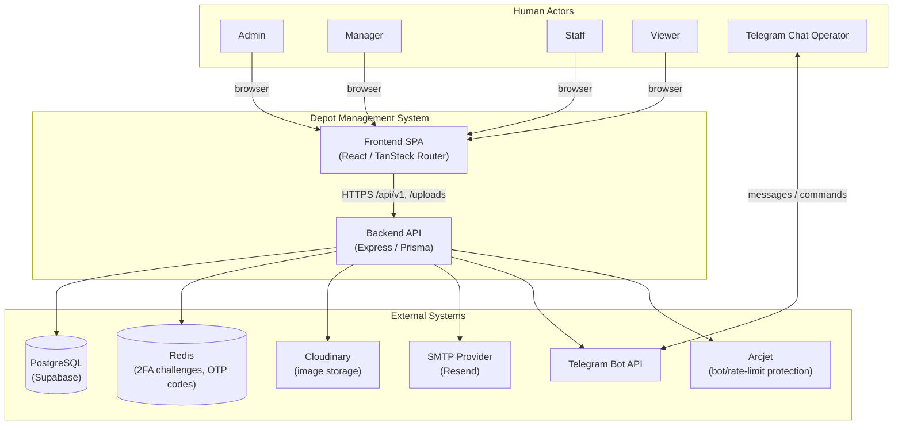

**Explanation:** The system boundary is the SPA + API pair. Redis is drawn as external because it is a separate process/container the API depends on for short‑lived state, not an in‑process cache. Arcjet and Cloudinary are optional (env‑gated / fallback‑to‑disk respectively) but included because both have real, evidenced integration code.

### 7.2 Use Case Diagram

**Purpose:** what each role can actually do, at module granularity (not one bubble per endpoint).

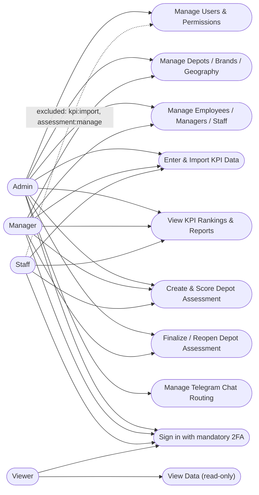

**Explanation:** `UC10` applies to every role identically because 2FA is mandatory system-wide, not opt-in per role (`docs/2fa-architecture.md`, `authService.login()`). The dashed line from Staff is used to make an *exclusion* explicit — `permissionCatalog.js` deliberately does not grant Staff `kpi:import` or `assessment:manage`.

### 7.3 Activity Diagram — Login with Mandatory 2FA

**Purpose:** the branching logic a login attempt actually goes through.

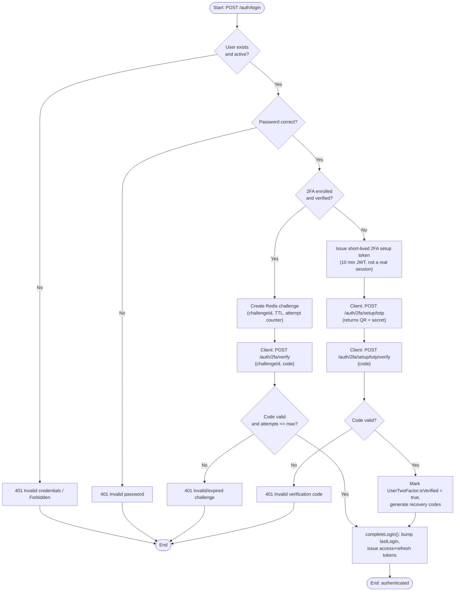

**Explanation:** Every login either ends unauthenticated, or reaches `completeLogin()` — there is no path to real tokens that skips both the password check and a 2FA step (challenge or first-time setup). The 10‑minute setup token issued at `I` is deliberately scoped: `authenticateForTwoFactorSetup` middleware only accepts it on the two `/2fa/setup/*` routes.

### 7.4 Activity Diagram — Depot Assessment Lifecycle

**Purpose:** the create → submit → finalize → reopen flow and its supersede rule.

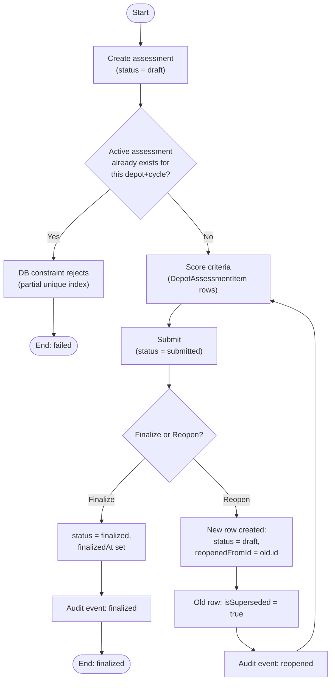

**Explanation:** Reopening never mutates the finalized row in place — it supersedes it and creates a fresh draft, preserving the finalized version's history for audit. The audit trail (`AssessmentAuditEvent`) is written at every named transition (`created`, `submitted`, `finalized`, `reopened`, `edited`), not just on success paths.

### 7.5 Entity Relationship Diagrams

Split into two diagrams for readability; both describe the same physical schema (`Backend/prisma/schema.prisma`).

**7.5a — Core / Geography / HR / Depot / Brand / KPI**

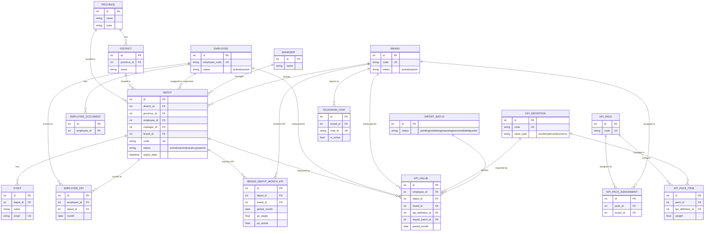

**7.5b — Auth / 2FA / Audit / Depot Assessment**

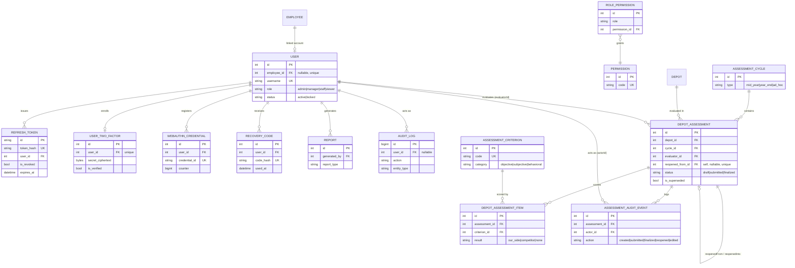

**Explanation:** The `DepotAssessment` self-relation (`reopenedFromId` unique FK, plus the inverse `reopenedInto`) is the one structurally unusual relationship in the schema and is called out explicitly because it's easy to misread as a simple one-to-many.

### 7.6 Class Diagram — Auth/2FA Service Layer (scoped)

**Purpose:** the actual code-level objects and their dependencies in the one part of the system with real singleton classes — *not* a redraw of the ERD. General CRUD modules (depots, brands, employees, …) are plain exported functions operating on Prisma directly and are already fully represented by the Component diagram + ERD; a class diagram for them would add nothing.

```mermaid
classDiagram
    class Database {
        -pool: pg.Pool
        -prisma: PrismaClient
        +healthCheck() Promise
        +disconnect() Promise
    }
    class JwtConfig {
        +generateAccessToken(payload)
        +generateRefreshToken(payload)
        +generateTwoFactorSetupToken(payload)
        +verifyAccessToken(token)
        +verifyAccessOrTwoFactorSetupToken(token)
        +verifyRefreshToken(token)
        +generateTokenPair(user)
    }
    class AuthService {
        +login(credentials)
        +verifyTwoFactorChallenge(challengeId, code)
        +completeLogin(userId)
        +requestPasswordReset(email)
        +resetPassword(email, otp, newPassword)
        +refreshToken(token)
        +logout(refreshToken)
    }
    class TwoFactorService {
        +setupTotp(userId, username)
        +verifySetupCode(userId, code)
        +isEnrolled(userId)
        +verifyLoginCode(userId, code)
    }
    class LoginChallengeService {
        +createChallenge(userId, methods)
        +getChallenge(challengeId)
        +incrementAttempt(challengeId)
        +deleteChallenge(challengeId)
    }
    class PasswordResetOtpService {
        +issue(userId)
        +verifyAndConsume(userId, code)
    }
    class PermissionService {
        +roleHasPermission(role, code)
        +setRolePermissions(role, ids)
    }

    AuthService --> JwtConfig : issues/verifies tokens
    AuthService --> Database : Prisma queries
    AuthService --> TwoFactorService : checks enrollment
    AuthService --> LoginChallengeService : login challenge
    AuthService --> PasswordResetOtpService : reset flow
    TwoFactorService --> Database
    LoginChallengeService --> "Redis" : external
    PasswordResetOtpService --> "Redis" : external
    PermissionService --> Database
```

### 7.7 Sequence Diagram — Login with Mandatory 2FA

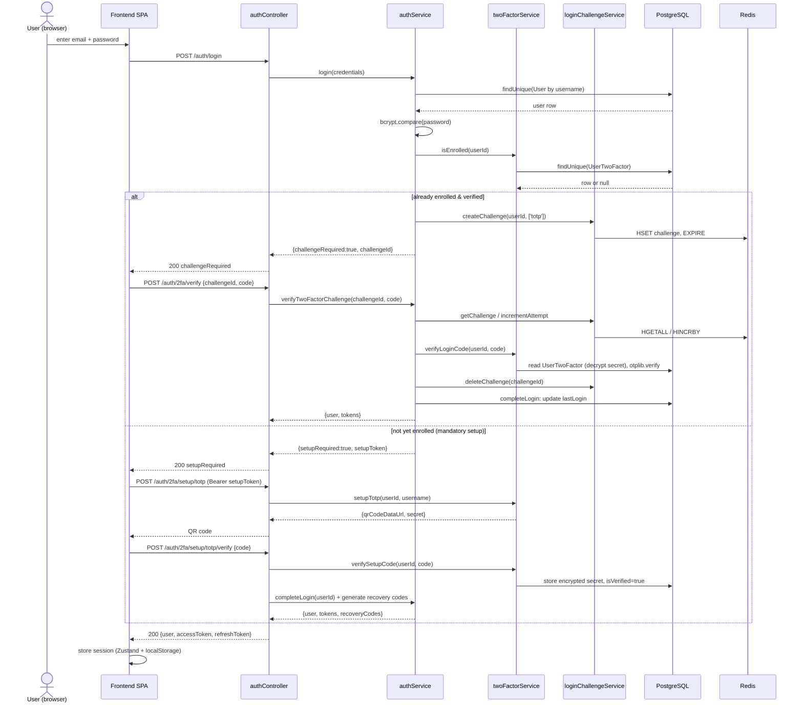

**Explanation:** Both branches converge on `completeLogin()`, which is the only place `lastLogin` is written and tokens are issued — confirming (from code, not assumption) that a successful login is never credited until 2FA actually completes.

### 7.8 Sequence Diagram — Password Reset via OTP

```mermaid
sequenceDiagram
    actor U as User
    participant FE as Frontend SPA
    participant API as authController
    participant Svc as authService
    participant OTP as passwordResetOtpService
    participant R as Redis
    participant Mail as mailer (SMTP)
    participant DB as PostgreSQL

    U->>FE: enter email
    FE->>API: POST /auth/forgot-password {email}
    API->>Svc: requestPasswordReset(email)
    Svc->>DB: findUnique(User by username)
    alt user exists and active
        Svc->>OTP: issue(userId)
        OTP->>R: SET cooldown NX; HSET code hash + TTL
        OTP-->>Svc: {code, expiresIn} or null (cooldown)
        Svc->>Mail: sendMail(code)
        Mail-->>Svc: delivered / logged (SMTP unconfigured)
    end
    Svc-->>API: {success:true} (always identical)
    API-->>FE: 200 "If that email is registered..."

    U->>FE: enter email + code + new password
    FE->>API: POST /auth/reset-password {email, otp, newPassword}
    API->>Svc: resetPassword(email, otp, newPassword)
    Svc->>DB: findUnique(User)
    Svc->>OTP: verifyAndConsume(userId, otp)
    OTP->>R: HGETALL, HINCRBY attempts, DEL on success/cap
    alt code valid
        Svc->>DB: transaction: update passwordHash,\nrevoke all RefreshToken
        Svc-->>API: {success:true}
        API-->>FE: 200 "Password reset successfully"
    else invalid/expired/exhausted
        Svc-->>API: throw 401 (identical message for every failure case)
        API-->>FE: 401 Invalid or expired verification code
    end
```

### 7.9 Sequence Diagram — Depot Assessment: Create → Submit → Finalize

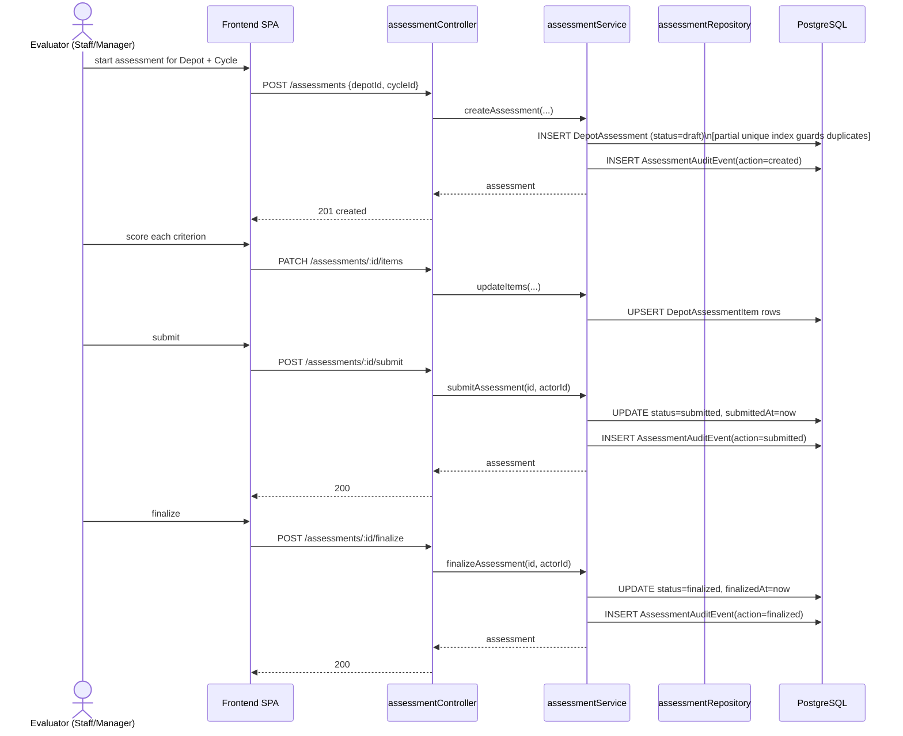

### 7.10 Component Diagram

**Purpose:** runtime software architecture — how the pieces divide.

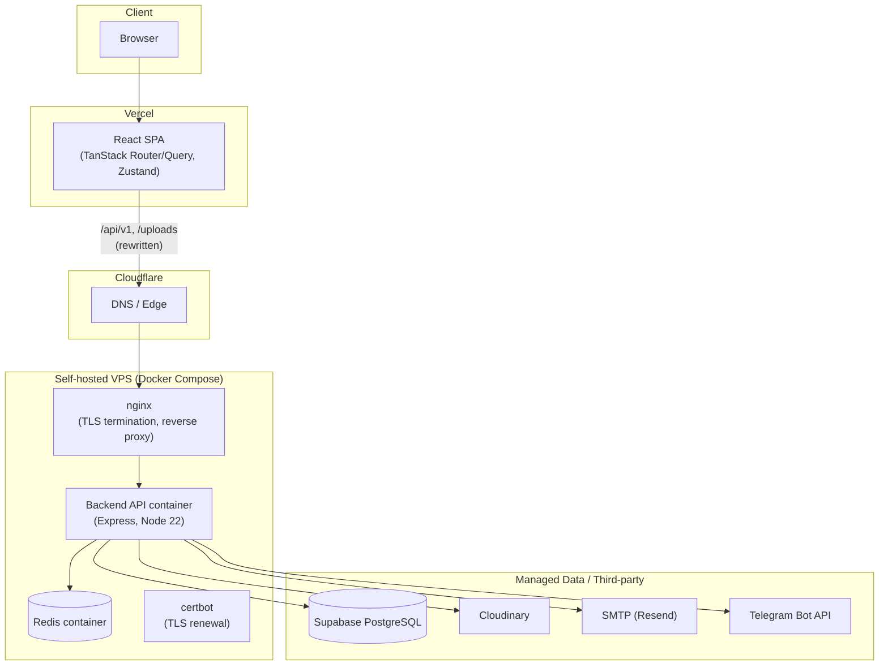

**Explanation:** `Nginx` and `certbot` are infrastructure components co-located with the API in the same Docker Compose stack (`deploy/docker-compose.yml`), not part of the application codebase itself — included because they're on the actual request path (TLS termination happens at nginx, not in Node).

### 7.11 Deployment Diagram

**Purpose:** where the system physically/virtually runs.

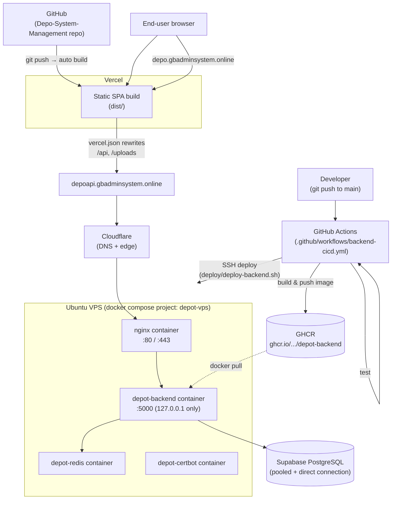

**Explanation:** This is the deployment path confirmed live in this project (SSH access to the VPS, `docker-compose.yml` content, successful GitHub Actions runs, live `curl` checks against `depoapi.gbadminsystem.online` returning the new code's routes). Project history/docs also reference an earlier Dokploy-hosted deployment and an earlier Render deployment of the same backend — both are **not** the currently-verified production path and are noted here only for completeness; `UNKNOWN` whether either is still running in parallel.

### 7.12 State Diagram — Depot Assessment

```mermaid
stateDiagram-v2
    [*] --> Draft: createAssessment()
    Draft --> Submitted: submitAssessment()
    Submitted --> Finalized: finalizeAssessment()
    Finalized --> Draft: reopenAssessment()\n(creates a NEW row;\nthis row -> isSuperseded=true)
    Finalized --> [*]
    Draft --> [*]: (abandoned, no terminal event found)

    note right of Finalized
        At most one non-superseded
        DepotAssessment per (depotId, cycleId),
        enforced by a partial unique DB index.
    end note
```

**Explanation:** `reopenAssessment()` does not transition the *same row* back to `Draft` — it supersedes the finalized row and inserts a new one that starts at `Draft`. The diagram shows this as leaving `Finalized` and re-entering at `Draft` to reflect the *conceptual* lifecycle a depot+cycle pair goes through, while the ERD (7.5b) shows the true one-row-per-version reality via `reopenedFromId`/`isSuperseded`.

### 7.13 State Diagram — Depot Operational Status

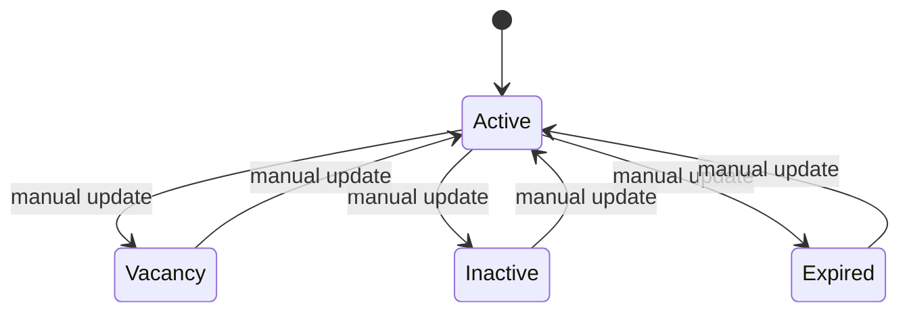

**Explanation:** All transitions are driven by an admin/manager calling `PATCH /depots/:id` — **no cron job or scheduled process was found that automatically moves a depot to `expired`** based on `Depot.expiryDate` (confirmed by a repo-wide search: the only registered cron jobs are Telegram report schedules). `expiryDate` is used for read-time filtering/dashboards (e.g. "expiring soon" counts), not for automated status mutation.

---

## PHASE 8 — Traceability

| Diagram Element | Existing Implementation |
|---|---|
| Actor: Admin/Manager/Staff/Viewer | `UserRole` enum (`schema.prisma`); `permissionCatalog.js` |
| Use case: "Sign in with mandatory 2FA" | `POST /api/v1/auth/login`, `authService.login()`, `docs/2fa-architecture.md` |
| Use case: "Manage Depots" | `POST/GET/PATCH/DELETE /api/v1/depots`, `depotController.js`, `depotService.js` |
| Use case: "Create & Score Depot Assessment" | `POST /api/v1/assessments`, `assessmentController.js`, `assessmentService.js` |
| Use case: "Finalize/Reopen Depot Assessment" | `POST /api/v1/assessments/:id/finalize`, `/reopen`, `assessmentService.finalizeAssessment`/`reopenAssessment` |
| ERD entity: `User` | `prisma.user` / `users` table |
| ERD entity: `DepotAssessment` | `prisma.depotAssessment` / `depot_assessments` table |
| ERD entity: `UserTwoFactor` | `prisma.userTwoFactor` / `user_two_factor` table (added by migration `20260917000000_add_2fa_tables`) |
| Sequence: 2FA challenge | `loginChallengeService.js` ↔ Redis key `2fa:challenge:*` |
| Sequence: password reset code | `passwordResetOtpService.js` ↔ Redis key `pwreset:otp:*` |
| Component: "Backend API container" | `Backend/Dockerfile` (`production` stage), `deploy/docker-compose.yml`'s `backend` service |
| Component: "Redis container" | `deploy/docker-compose.yml`'s `redis` service, `src/config/redis.js` |
| Deployment: GHCR image | `.github/workflows/backend-cicd.yml`'s `build` job (`ghcr.io/<owner>/depot-backend`) |
| Deployment: VPS deploy + rollback | `deploy/deploy-backend.sh` |
| State: Depot status enum | `DepotStatus` enum, `depotService.js` (status filters), no automated-transition code found |
| State: Assessment status enum | `DepotAssessmentStatus` enum, `assessmentService.js`'s `submitAssessment`/`finalizeAssessment`/`reopenAssessment` |

---

## PHASE 9 — Missing Documentation

### Required

- **API reference** — no OpenAPI/Swagger spec found; the ~110 endpoints across 14 route files are documented only by reading source. A `postman_collection.json` exists at `Backend/` but a Postman collection is not a substitute for a maintained API contract.
- **Environment/configuration reference** — `.env.example` exists and is reasonably commented, but there is no single document explaining which variables are required in which environment (dev/CI/production), especially the production fail-fast list in `env.js` (`DATABASE_URL`, `JWT_SECRET`, `JWT_REFRESH_SECRET`, `TOTP_ENCRYPTION_KEY`) versus the optional ones (SMTP, Cloudinary, Arcjet, metrics token).
- **Permission catalog reference** — `DEFAULT_PERMISSIONS`/`DEFAULT_ROLE_PERMISSIONS` in `permissionCatalog.js` are only a *seed*; the live source of truth is the `role_permissions` table, editable via `/api/v1/permissions`. There is no document explaining that the seed and the live table can drift, or what re-running the seed does to a customized table.

### Recommended

- **Resolution of the "two KPI subsystems" question** — the dynamic KPI engine (`KpiDefinition`/`KpiPack`/`KpiValue`/`ImportBatch`, mounted at `/api/v1/kpis`) and the simpler `BrandDepotMonthKpi` model (`/api/v1/kpis/brand-monthly`) are both live and both actively used by different parts of the frontend (`kpi-system` feature). Nothing in the repo explains which one is authoritative for which report, or whether this is an intentional two-tier design (granular per-employee KPI vs. per-brand-depot-month KPI) or a partial migration in progress. This is stated as fact (both are wired and used), not assumption — but *why* two systems coexist is `UNKNOWN` from code alone.
- **Audit log read path** — `AuditLog` is written by services but no route was found to read it back (`/api/v1/audit-logs` or similar does not exist in the route inventory). Worth documenting whether this is intentional (DB-only access) or a planned-but-unbuilt feature.
- **WebAuthn / passkey status** — `WebAuthnCredential` exists in the schema (and the 2FA architecture doc anticipated it — "WebAuthn preferred, TOTP required fallback") but no route, controller, or service references it. Should be documented as **schema-only, not implemented**, so it isn't mistaken for a working feature.
- **Dead-code note for the session/Upstash path** — `middleware/sessionStore.js` and the `@upstash/redis`/`express-session`/`connect-redis` dependencies are unused at runtime (verified by grep). Worth either removing or documenting as intentionally-retained-but-inactive, so a future maintainer doesn't assume session-based auth is a real alternative to the JWT flow.
- **Frontend "Clerk" route group** — `depo-system-frontend/src/routes/clerk/*` and the `@clerk/react` dependency exist (inherited from the open-source `shadcn-admin` template this app was scaffolded from), but the real authenticated app shell (`_authenticated/route.tsx`) guards via the project's own `useAuthStore`, not Clerk. Worth a one-line note so it isn't mistaken for a second, parallel auth system.
- **Deployment-history note** — docs and env defaults still reference a Dokploy-hosted backend and a Render-hosted backend from earlier in the project's history; only the GitHub Actions → VPS path was verified live this session. A short "current production path" note would prevent confusion.

### Optional

- **Architecture Decision Records** for notable, already-justified-in-code decisions that currently live only as source comments (e.g., why Redis over Postgres for 2FA/OTP state; why `sslmode` is stripped from the Supabase connection string; why the partial-unique-index carve-out for one historical duplicate assessment exists).
- **Error-code catalog** — `ErrorCodes`/`AppError` (`src/utils/app-error.js`) define a consistent error-code convention; a short reference table would help frontend error handling.

---

## PHASE 10 — Recommended Documentation Structure

```text
01. System Overview
    ├── Purpose & Scope (Phase 1/2 of this document)
    └── System Context Diagram (7.1)

02. Actors & Requirements
    ├── Actors (2.1)
    ├── Role/Permission Catalog (2.4, §9 "Required")
    └── Use Case Diagram (7.2)

03. Business Processes
    ├── Login & Mandatory 2FA (5.1, 7.3, 7.7)
    ├── Password Reset via OTP (5.2, 7.8)
    ├── Depot & KPI Excel Import (5.3, 5.4)
    ├── Depot Assessment Lifecycle (5.5, 7.4, 7.9, 7.12)
    └── Telegram Reporting (5.6)

04. Data Architecture
    ├── Domain Entities (2.3)
    ├── ERD — Core/HR/Depot/Brand/KPI (7.5a)
    └── ERD — Auth/2FA/Audit/Assessment (7.5b)

05. Application Architecture
    ├── Architecture Style & Layering (Phase 6)
    ├── Class Diagram — Auth/2FA services (7.6)
    └── Functional Module Map (2.2)

06. Interaction Architecture
    └── Sequence Diagrams (7.7, 7.8, 7.9)

07. State & Lifecycle
    ├── Depot Assessment (7.12)
    └── Depot Operational Status (7.13)

08. Infrastructure
    ├── Component Diagram (7.10)
    └── Deployment Diagram (7.11)

09. API & Integration
    ├── Route inventory (2.2, this doc's evidence)
    └── External Systems (2.4)

10. Security
    ├── Authentication (JWT + mandatory TOTP 2FA)
    ├── Authorization (role + DB-backed permission table)
    └── Secrets/production fail-fast list (§9 "Required")

11. Deployment & Operations
    ├── CI/CD (.github/workflows/backend-cicd.yml)
    ├── Environments (dev / CI / production)
    └── Observability (Winston, /metrics, health checks)

12. Traceability
    └── Phase 8 table
```

---

## Final Recommended Diagram Set

The smallest set that accurately explains this system, in priority order:

1. **ERD (7.5a, 7.5b)** — the schema is the system's ground truth.
2. **Deployment Diagram (7.11)** — multi-host, multi-provider, fully evidenced.
3. **Sequence: Login+2FA (7.7)** — the system's most security-critical, most-branched flow.
4. **Component Diagram (7.10)** — clarifies the client-server split and every external dependency.
5. **State: Depot Assessment (7.12)** — the one entity with a genuinely rich, audited lifecycle.
6. **Context Diagram (7.1)** — cheapest diagram to produce, highest onboarding value.
7. **Activity: 2FA login (7.3) and Assessment lifecycle (7.4)** — make the branching in #3/#5 legible to non-developers.
8. **Sequence: Password reset (7.8), Sequence: Assessment create→finalize (7.9)** — supporting detail once the above are understood.
9. **Use Case Diagram (7.2), Class Diagram (7.6), State: Depot status (7.13)** — genuinely useful but lower priority; the system can be understood without them if time is constrained.

DFD and a full domain-entity Class Diagram were deliberately omitted, per Phase 3/4's reasoning, as redundant with diagrams already in this set.
